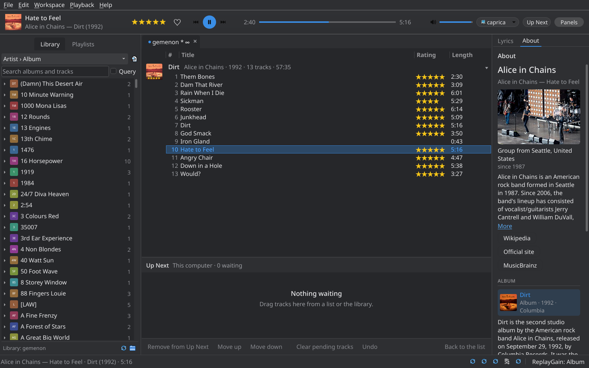
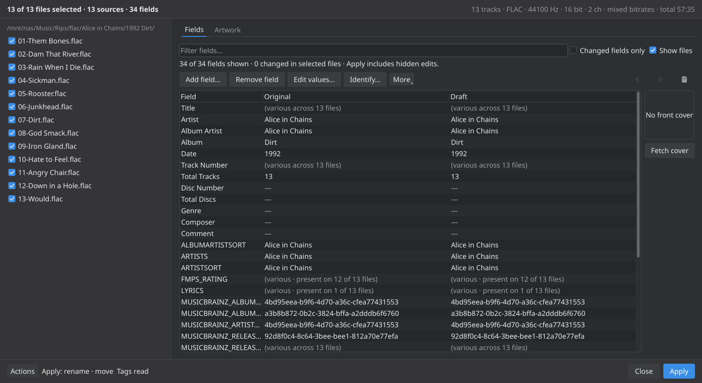
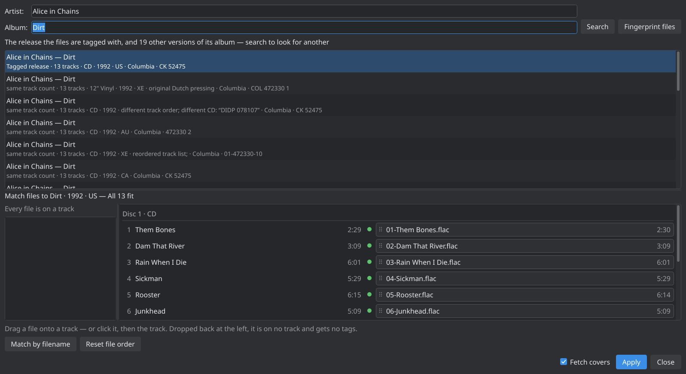
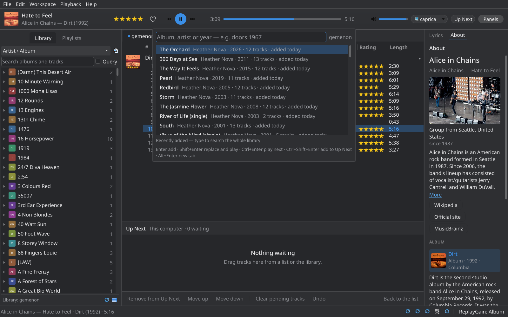

# Melody

A music player and tag editor for Linux and macOS, in the spirit of foobar2000.

https://github.com/user-attachments/assets/b9a632b7-b762-4c15-878f-834c84856879

Melody is two programs: **`melody`**, the desktop app, and **`melodyd`**, the
engine that keeps the library and plays the music. Around them are a few
small ones: `melody-agent` for speakers elsewhere, `melody-cli` for scripts
and status bars, `melody-pick` for picking an album from a launcher,
`melody-watch` for a NAS that can't run the engine, and an Android app.

## What's different

- **Playback runs in its own engine.** `melodyd` plays the music and
  Melody is one of its clients. Close the window and the music keeps
  going. Run the engine on a server and every client shares its library,
  queue, playlists and history.
- **Computers, phones, and UPnP speakers are outputs.** Another computer, a
  Raspberry Pi, your phone, or a network renderer can play for the engine,
  each with its own volume and ReplayGain.
- **A proper tag editor.** Edit many files at once, look albums up on
  MusicBrainz, fix covers, scan ReplayGain, convert and rename. You see every
  change before it's written, and can undo it while the editor is open.
- **Identify albums, one or many.** Melody finds the release your files
  belong to, shows the other versions of the album, and matches files to
  tracks on one board, coloured by how well they fit. Drag a file to fix a
  match. Covers come along when you apply.
- **Plugins.** Add your own entries to the right-click menu, panels beside
  the playlist, and scripts that run when new albums arrive. Plugins can be
  written in any language. Melody comes with lyrics, an About panel for the
  playing artist and album (with the albums you're missing), web search, and
  your own shell commands.
- **Listen together.** Friends hear the same album at the same moment, each
  on their own speakers. Those without the track get the host's copy, and
  those without Melody listen in the browser.
- **Keyboard first.** Playlists grouped by album, with covers, a command
  palette that finds every menu entry, Quick album and Quick track to find
  anything as you type, and a shortcut for everything.
- **Search with a query language**, dynamic playlists from rules or Last.fm,
  favourites, Up Next, and scrobbling done by the engine, so it works with
  the app closed. Saved playlists are plain files in your playlist folder.
- **The engine watches your music folders**, so new and changed albums show
  up without a rescan. Moves and renames take playlists, history and ratings
  with them.
- **An Android app** that controls the engine, plays on the phone and keeps
  albums for offline listening.

  
  
  
  
  
  
  

  
  
  
  
  

## Docs

- [Installation](docs/install.md)
- [Setup](docs/setup.md)
- [How the engine, agents and phone connect](docs/melody.md), including a
  headless `melodyd`
- [Listening together](docs/together.md)
- [Writing a plugin](docs/plugins.md), and the [plugins that come with
  Melody](plugins/README.md)
- [Tagging scripts](docs/tagging-scripts.md)
- [Formatting syntax](docs/formatting.md), for naming files and library views
- [Search queries](docs/query-language.md)
- [Everything else](docs/README.md)

## Plugins

A plugin is a program of your own, in any language. Melody runs it and tells
it in JSON what was chosen or what is playing. A plugin can add entries to the
right-click menu ("Share album" through your own server, say), show a panel
beside the playlist, or run when something happens: a new album, a library
change, a timer, Melody starting.
[Writing a plugin](docs/plugins.md) has all of it, and
[`examples/plugins`](examples/plugins) a plugin to start from. Plugins live in
repositories of their own; the GitHub topic
[`melody-plugin`](https://github.com/topics/melody-plugin) finds them.

This is new software and still changing. For a bug report, run
`melody --debug` in a terminal and include the output.

## History

This repository was called `melody-next`. The earlier Melody, a Go music
server that spoke the MPD protocol, is archived as
[melody-music-mpd](https://github.com/carnager/melody-music-mpd).

## License

GPL-3.0-only. See [LICENSE](LICENSE).
